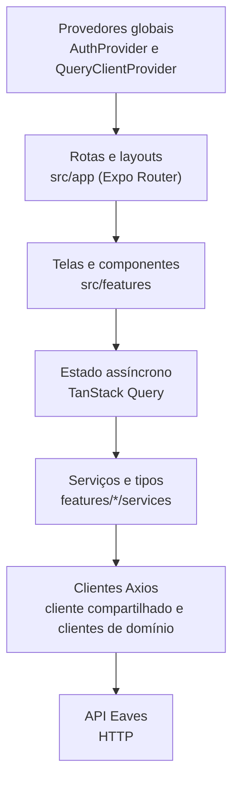

# Aplicativo Eaves

Aplicativo mobile e web do Eaves, desenvolvido com React Native, Expo e TypeScript. O projeto usa Expo Router para navegação por arquivos e NativeWind para estilos utilitários.

## Requisitos

- Node.js e npm.
- Expo Go para testes em dispositivo compatível, ou Android Studio para executar em um emulador Android.
- A API Eaves configurada e acessível para os fluxos que dependem do servidor.

## Configuração

Na pasta `app/`, instale as dependências:

```bash
npm install
```

Crie um arquivo `.env` na pasta `app/` e configure a URL base da API:

```env
EXPO_PUBLIC_API_URL=http://localhost:3000
EXPO_PUBLIC_MICROSOFT_CLIENT_ID=seu-client-id-do-entra
```

Cadastre o aplicativo no Microsoft Entra ID como cliente público e habilite o fluxo de código de autorização com PKCE. Configure `eaves://auth` como URI de redirecionamento para os builds nativos e também cadastre a URI exibida em desenvolvimento web/Expo Go, quando aplicável. Use o mesmo Client ID na variável `MICROSOFT_CLIENT_ID` da API. O login Microsoft autentica contas Eaves já cadastradas; o cadastro completo continua sendo feito pelo fluxo normal do app.

Em um celular físico, `localhost` aponta para o próprio aparelho. Use o IP local do computador que está executando a API, por exemplo `http://192.168.1.20:3000`, e mantenha os dois dispositivos na mesma rede.

## Executar

```bash
npx expo start
```

No terminal do Expo, escolha o destino desejado. Também estão disponíveis estes atalhos:

```bash
npm run android
npm run ios
npm run web
```

Os comandos `android` e `ios` executam builds nativos locais e exigem as ferramentas de desenvolvimento correspondentes. Para verificar o projeto com o lint configurado:

```bash
npm run lint
```

### Aplicativo web instalável

O destino web usa um manifesto PWA para permitir que o Eaves seja instalado na tela inicial ou como aplicativo de desktop. Durante o desenvolvimento, execute `npm run web`; para gerar os arquivos de produção, execute:

```bash
npm run build:web
```

O resultado fica em `dist/`. Publique esse diretório em um domínio com HTTPS (ou teste localmente em `localhost`) para que os navegadores permitam a instalação. Em navegadores compatíveis, use a opção de instalar/adicionar à tela inicial. O app continua precisando de conexão com a API para os recursos que dependem do servidor.

## Arquitetura do aplicativo

O app segue uma arquitetura em camadas leves, organizada em torno das rotas e das funcionalidades. O Expo Router resolve a navegação; as telas delegam operações de dados aos serviços de cada funcionalidade; esses serviços usam clientes Axios para conversar com a API NestJS.



### Estrutura

```text
src/
├── app/                 # Rotas, grupos de navegação e layouts do Expo Router
├── features/
│   ├── auth/            # Login, cadastro, autenticação Microsoft e formulários
│   └── surveys/         # Questionários PHQ, respostas e acesso à API de surveys
├── components/          # Componentes compartilhados e provedores globais
├── hooks/               # Acesso compartilhado à sessão/autenticação
├── shared/              # Infraestrutura comum, como o cliente HTTP
└── templates/           # Composições reutilizáveis da interface, como o card diário
```

- **Navegação e proteção de rotas:** `src/app/` contém os arquivos de rota. O grupo `(auth)` apresenta login e cadastro; o grupo `(app)` verifica a sessão e redireciona usuários não autenticados para o login. As telas das funcionalidades ficam em `src/features/`, separadas dos pontos de entrada de navegação.
- **Composição da aplicação:** o layout raiz configura fontes e envolve as rotas com `QueryClientProvider` e `AuthProvider`. O provedor de autenticação mantém a sessão em contexto; os hooks em `src/hooks/` oferecem acesso a ela.
- **Funcionalidades por domínio:** cada pasta em `src/features/` concentra suas telas, componentes, hooks, tipos e serviços relacionados. Atualmente, os domínios implementados incluem autenticação e questionários PHQ.
- **Acesso a dados:** TanStack Query coordena consultas e mutações usadas pelas telas, e TanStack Form estrutura formulários. Os serviços de cada domínio encapsulam as chamadas HTTP e os clientes específicos podem ser configurados para suas rotas da API.
- **HTTP e sessão:** `src/shared/http.client.ts` define a configuração Axios compartilhada. As requisições autenticadas recebem o token da sessão; respostas `403` limpam o token e encerram a sessão no provedor.
- **Interface multiplataforma:** telas e componentes usam React Native; componentes com implementação dependente da plataforma, como o seletor de data, possuem arquivos específicos para web e nativo.

### Fluxo de uma operação

Por exemplo, ao responder ao questionário diário, a rota em `src/app/` carrega a tela PHQ de `src/features/surveys/`. A tela usa TanStack Query para obter perguntas ou enviar respostas; o `surveyService` encaminha as chamadas pelo cliente de surveys e a resposta da API atualiza o estado apresentado na interface. O mesmo padrão de serviço por domínio é usado pela autenticação.

Para iniciar o restante do ambiente e configurar a API, consulte o [README principal](../README.md) e o [guia do servidor](../server/README.md).

## Documentação

- [Expo](https://docs.expo.dev/)
- [Expo Router](https://docs.expo.dev/router/introduction/)
- [React Native](https://reactnative.dev/docs/getting-started)
